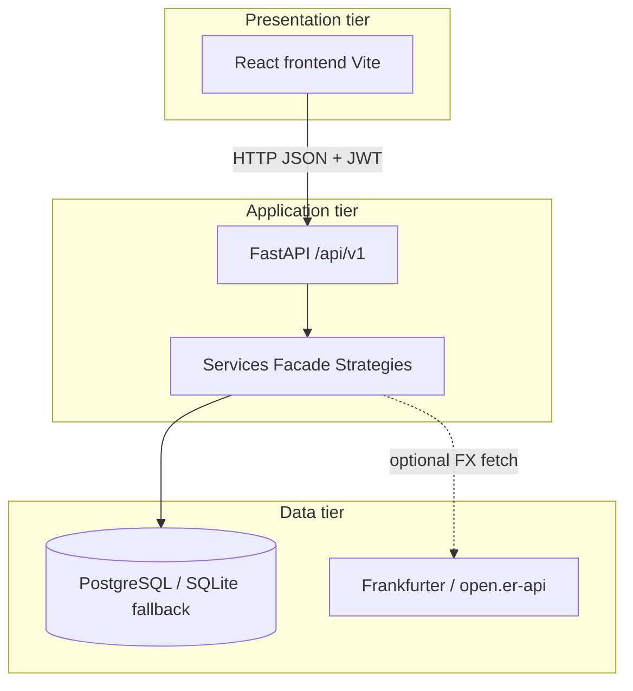
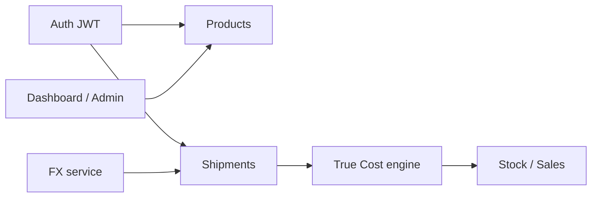
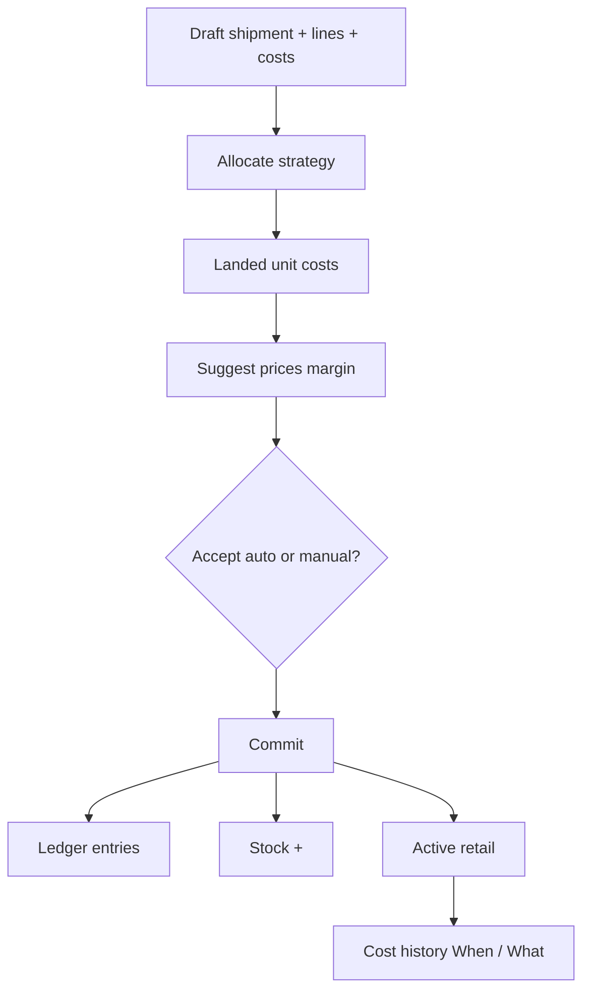

# Tranz-Algo — Architecture (as built)

**Status:** Complete for MVP  
**Updated:** 2026-10-15  
**Platform:** FastAPI + React (Vite) web admin + PostgreSQL (SQLite fallback)

---

## 1. Three-tier overview



```text
┌─────────────────────────────┐
│  React SPA (Vite :5173)     │
│  Auth · Theme · Pages       │
└──────────────┬──────────────┘
               │ HTTP JSON + JWT
               ▼
┌─────────────────────────────┐
│  FastAPI (/api/v1 :8000)    │
│  Routers → Services → ORM   │
└──────────────┬──────────────┘
               │
               ▼
┌─────────────────────────────┐
│  PostgreSQL (primary)       │
│  SQLite fallback if offline │
└─────────────────────────────┘
         │
         ▼ (optional)
   Frankfurter / open.er-api  (FX)
```

---

## 2. System components / modules



| Module | Backend | Frontend |
|---|---|---|
| Auth | `api/v1/auth.py` | `LoginPage`, `auth.jsx` |
| Products | `api/v1/products.py` | `ProductsPage` |
| Shipments | `api/v1/shipments.py` | `ShipmentsPage`, `ShipmentDetailPage` |
| True Cost | `shipment_workflow.py`, `costing.py` | `TrueCostPage` |
| FX | `fx.py`, `strategies/fx_providers.py` | Fetch FX on shipment costs |
| Stock | `api/v1/inventory.py` | `InventoryPage` |
| Admin | `api/v1/admin.py` | `DashboardPage` Start fresh |

---

## 3. Costing workflow (True Cost)



---

## 4. Backend layering

| Layer | Location | Role |
|---|---|---|
| HTTP | `app/api/v1/*` | Controllers |
| Workflow Facade | `app/services/shipment_workflow.py` | Allocate / suggest / commit (+ optional safety-floor helper) |
| Costing | `app/services/costing.py` + `strategies/` | Strategy + Factory |
| FX | `app/services/fx.py` + `strategies/fx_providers.py` | Chain of Responsibility |
| Models / DB | `app/models`, `app/db` | SQLAlchemy 2 |
| Security | `app/core/security.py` | JWT + bcrypt |

Patterns detail: [software_engineering_principles.md](./software_engineering_principles.md)  
Data model: [erd.md](./erd.md)

---

## 5. Frontend modules

| Area | Location | Role |
|---|---|---|
| Routing / shell | `App.jsx`, `AppShell.jsx` | Welcome, login, closable sidebar |
| Auth | `auth.jsx`, `api.js` | JWT in `localStorage` |
| Theme | `theme.jsx` | Day / Night / Sienna |
| Cost modes | `costModes.js` | Already-Local / Auto FX (`PRIMARY_COST_MODES`) |
| Pages | `pages/*` | Dashboard, Products, Shipments, Stock, True Cost |

---

## 6. Proposal → as-built technology deltas

| Proposal | As built | Rationale |
|---|---|---|
| React Native / Expo | React web SPA | Admin desk workflow; MVP focus on costing |
| PostgreSQL (Supabase) required | PostgreSQL via Docker/local (`DATABASE_URL`); SQLite fallback | Real DB for demos; SQLite if offline |
| Continuous “real-time” FX | On-demand fetch + cache + manual | Paperwork timing; API resilience |
| Smartphone camera | Not required for MVP | No barcode core path |

---

## 7. Main user journeys

1. **Welcome** → Sign in / Register  
2. **Products** (optional auto `PRD-000N` SKU)  
3. **Shipments** → lines + costs  
4. **True Cost** → allocate → suggest/override → commit  
5. **Stock** → Record sale (stock-out only)  
6. Committed shipment → **Cost history** (When / What)  

---

## 8. Account model

Single account type: registered users receive `role=admin`. No separate customer portal in the MVP.

## 9. Security (summary)

- bcrypt password hashes  
- JWT Bearer on protected routes  
- Pydantic validation  
- CORS limited to configured origins  
