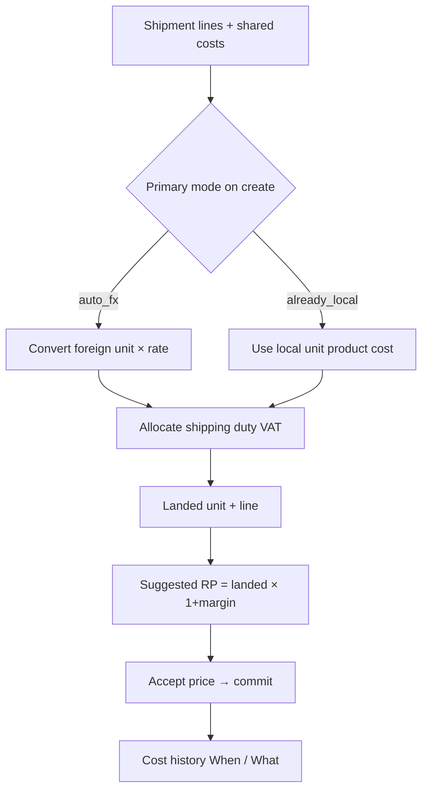

# Dual Cost Modes, Allocation & Worked Formula Examples

**Design freeze:** Week 1 Day 1  
**Updated:** 2026-10-15 — dual modes only in UI; duty/VAT from paperwork totals; Cost history after commit  
**Status:** Complete  
**Owners:** Nixon + Musonda  
**As built:** Primary UI modes are Already-Local and Auto FX (chosen on create). Quantity + weight allocation in UI; value-based supported in engine. After suggest, UI offers auto-accept vs manual retail before commit; live **safety floor** (`Landed × 1.1`) on True Cost adjust — no post-commit recheck. CI locks **demo** oracles in `backend/tests/test_costing.py`; Examples A/B below are report worked examples of the same formulas.

---

## 1. Dual cost-entry modes



### Auto FX mode
Use when supplier product prices are still in foreign currency. **Fetch FX** is available on shipment costs for this mode.

**Required inputs**
- Foreign currency code (e.g. `USD`)
- Exchange rate (Fetch FX / cache / manual)
- Per-item `foreign_unit_price` + `quantity`
- Local shipping total (and duty/VAT totals from clearing paperwork)

**System actions**
1. Convert product lines to local currency  
2. Allocate shipping / duty / VAT shares  
3. Compute landed cost + suggested price  

### Already-Local mode
Use when shipper/clearing agent paperwork already shows local amounts. No Fetch FX on this path.

**Required inputs**
- Per-item `local_unit_product_cost` + `quantity`
- Local shipping total
- Local duty/VAT totals from paperwork
- `paperwork_source` text (for Cost history)

**System actions**
1. Skip FX conversion for product lines  
2. Allocate shared local shipping and tax totals  
3. Compute landed cost + suggested price  
4. Record paperwork source in Cost history on commit  

### Mixed paperwork (concept)
Real imports often mix a foreign supplier invoice with local clearing totals. In the MVP UI, choose **Auto FX** or **Already-Local** as the primary mode; shipping/duty/VAT are still pasted as local paperwork totals in both cases. A separate “Mixed” primary mode is not shown in the UI.

---

## 2. Core formulas

### Auto FX product conversion
```text
LocalProductCost_i = ForeignUnitPrice_i × ExchangeRate
```

### Shipping share
```text
Weight-based:    ShippingShare_i = (weight_i / total_weight) × shipping_total
Quantity-based:  ShippingShare_i = (qty_i / total_qty) × shipping_total
Value-based:     ShippingShare_i = (line_value_i / total_line_value) × shipping_total   # stretch
```
where `line_value_i` is local product line value after conversion/entry.

### Duty / VAT (paperwork totals)
```text
DutyShare_i  = (basis_i / total_basis) × duty_total
VATShare_i   = (basis_i / total_basis) × vat_total
```
where `basis` is the same as shipping (weight or quantity).

**MVP policy (freeze this):**  
- Paste duty/VAT **totals from clearing paperwork** on the shipment.  
- Allocate those totals by the selected allocation method (same basis as shipping).  
- Missing totals are treated as zero.

### Landed cost
```text
Auto FX / converted:
LandedLineCost_i = (LocalProductCost_i × qty_i) + ShippingShare_i + Duty_i + VAT_i
LandedUnitCost_i = LandedLineCost_i / qty_i

Already-Local:
LandedLineCost_i = (LocalUnitProductCost_i × qty_i) + ShippingShare_i + Duty_i + VAT_i
LandedUnitCost_i = LandedLineCost_i / qty_i
```

### Price suggestion
```text
SuggestedRP_i = LandedUnitCost_i × (1 + ProfitMargin)
```

### Safety floor (True Cost pricing)
```text
Floor_i = LandedUnitCost_i × (1 + SafetyMargin)   # default safety 10%
```
Live UI: while adjusting profit margin or manual retail on True Cost, flag lines where suggested/entered price is below floor. No post-commit recheck button — **Cost history** after commit. Scenario 04 covers the formula + UI replay.

Rounding: store money at 2 decimal places; tests allow `<= 0.01` difference vs spreadsheet oracle.

---

## 3. Worked example A — Auto FX

**Batch:** design worked example (classroom / scenarios use `SHP-DEMO-AUTO-FX` in `docs/scenarios/`)  
**FX:** `1 USD = 27.00 ZMW` (manual/API)  
**Shipping:** `200 USD` → `5400.00 ZMW`  
**Allocation compare:** weight vs quantity  
**Duty total (paperwork):** `1215.00 ZMW`  
**VAT total (paperwork):** `2138.40 ZMW`  
**Profit margin:** 30%

### Items

| Item | Qty | Weight kg | Foreign unit (USD) |
|---|---:|---:|---:|
| A Fan | 10 | 5.0 each → 50 total | 20.00 |
| B Blender | 5 | 3.0 each → 15 total | 30.00 |
| C Kettle | 10 | 1.5 each → 15 total | 10.00 |
| **Total** | **25** | **80** | |

### Step 1 — Convert product lines

| Item | Local unit | Local line product |
|---|---:|---:|
| A | 20 × 27 = **540.00** | 5400.00 |
| B | 30 × 27 = **810.00** | 4050.00 |
| C | 10 × 27 = **270.00** | 2700.00 |
| **Total product** | | **12150.00** |

### Step 2 — Shipping shares (`shipping_total = 5400`)

**Weight-based**

| Item | Weight share | Shipping share |
|---|---:|---:|
| A | 50/80 | 3375.00 |
| B | 15/80 | 1012.50 |
| C | 15/80 | 1012.50 |

**Quantity-based**

| Item | Qty share | Shipping share |
|---|---:|---:|
| A | 10/25 | 2160.00 |
| B | 5/25 | 1080.00 |
| C | 10/25 | 2160.00 |

### Step 3 — Duty/VAT shares (`duty_total = 1215`, `vat_total = 2138.40`, **weight**)

| Item | Weight share | Duty share | VAT share |
|---|---:|---:|---:|
| A | 50/80 | 759.38 | 1336.50 |
| B | 15/80 | 227.81 | 400.95 |
| C | 15/80 | 227.81 | 400.95 |

### Step 4 — Landed cost (using **weight** allocation)

| Item | Product | Ship | Duty | VAT | Line landed | Unit landed |
|---|---:|---:|---:|---:|---:|---:|
| A | 5400.00 | 3375.00 | 759.38 | 1336.50 | **10870.88** | **1087.09** |
| B | 4050.00 | 1012.50 | 227.81 | 400.95 | **5691.26** | **1138.25** |
| C | 2700.00 | 1012.50 | 227.81 | 400.95 | **4341.26** | **434.13** |

### Step 5 — Suggested RP (30% margin)

| Item | Unit landed | Suggested RP |
|---|---:|---:|
| A | 1087.09 | **1413.22** |
| B | 1138.25 | **1479.73** |
| C | 434.13 | **564.37** |

*(Suggested = landed_unit × 1.30, rounded to 2 dp.)*

---

## 4. Worked example B — Already-Local

**Batch:** design worked example (classroom / scenarios use `SHP-DEMO-LOCAL-ZMW` in `docs/scenarios/`)  
**Paperwork source:** Clearing agent invoice CA-778; shipper freight note FR-221  
**Shipping (local):** `3000.00 ZMW`  
**Duty total (manual batch):** `900.00 ZMW`  
**VAT total (manual batch):** `1200.00 ZMW`  
**Allocation method selected:** quantity  
**Profit margin:** 25%

### Items (already local unit product costs)

| Item | Qty | Weight kg (info only) | Local unit product |
|---|---:|---:|---:|
| A Fan | 10 | 50 total | 500.00 |
| B Blender | 5 | 15 total | 750.00 |
| C Kettle | 10 | 15 total | 250.00 |
| **Total qty** | **25** | | |

### Product lines

| Item | Product line |
|---|---:|
| A | 5000.00 |
| B | 3750.00 |
| C | 2500.00 |
| **Total** | **11250.00** |

### Allocate shipping / duty / VAT by quantity

| Item | Qty share | Ship share | Duty share | VAT share |
|---|---:|---:|---:|---:|
| A | 10/25 | 1200.00 | 360.00 | 480.00 |
| B | 5/25 | 600.00 | 180.00 | 240.00 |
| C | 10/25 | 1200.00 | 360.00 | 480.00 |

### Landed + suggested (25%)

| Item | Line landed | Unit landed | Suggested RP |
|---|---:|---:|---:|
| A | 5000+1200+360+480 = **7040.00** | **704.00** | **880.00** |
| B | 3750+600+180+240 = **4770.00** | **954.00** | **1192.50** |
| C | 2500+1200+360+480 = **4540.00** | **454.00** | **567.50** |

---

## 5. Safety-floor mini example

On True Cost **Price** stage, if unit landed is **820.00** and safety margin is 10%:

```text
Floor = 820.00 × 1.10 = 902.00
Suggested/manual RP 880.00 < 902.00 → UI flags below floor (live, before commit)
```

This is a **pre-commit** guard while adjusting margin/retail. After commit, use **Cost history** — there is no automatic post-commit margin recheck in the MVP UI.

---

## 6. Unit-test seeds

CI fixtures in `backend/tests/test_costing.py` lock the **demo shipments** (`SHP-DEMO-LOCAL-ZMW` quantity, `SHP-DEMO-AUTO-FX` weight @ 20).  
Examples A/B above remain report worked examples of the same formulas. See `docs/scenarios/`.
