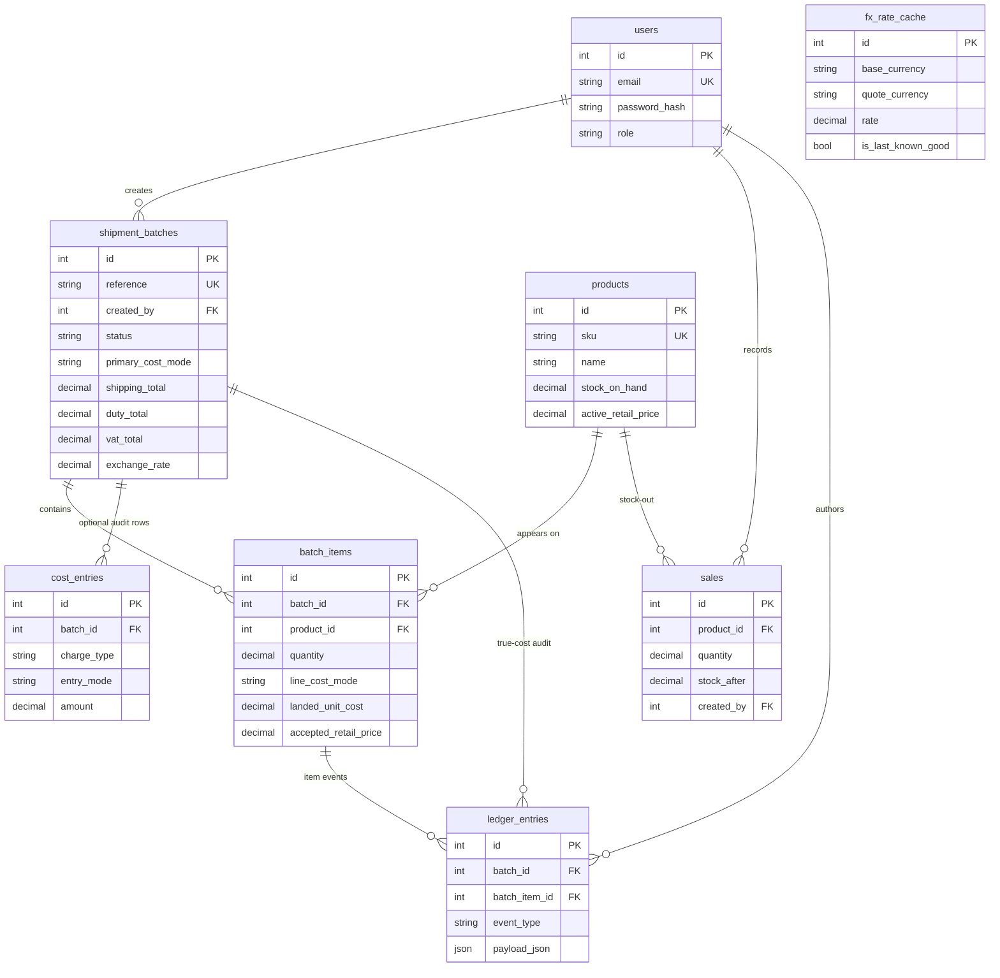
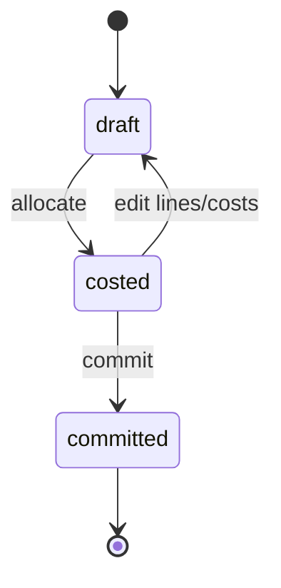

# Tranz-Algo — ERD & Data Dictionary

**Design freeze:** Week 1 Day 1  
**Updated:** 2026-10-15 — matches `backend/app/models/__init__.py` (tax profiles removed)  
**Owners:** Nixon + Musonda Katongo  
**Status:** Complete  

**SKU note:** Products may receive an auto-generated SKU (`PRD-000N`) when the client omits one; the `sku` column remains unique and required at persistence.  
**IDs:** All primary keys are **integer serial** (not UUID).

---

## Entity relationship diagram (presentation-ready)



### ASCII overview (for Word / PPT paste)

```text
     ┌─────────────┐        ┌──────────────┐
     │  products   │───────▶│ batch_items  │
     └──────┬──────┘  1:N   └──────▲───────┘
            │                      │
            │ 1:N sales            │ N:1
            ▼                      │
     ┌─────────────┐        ┌──────┴───────────┐
     │    sales    │        │ shipment_batches │◀── users (creates)
     └─────────────┘        └────────┬─────────┘
                                     │
                    ┌────────────────┼────────────────┐
                    ▼                ▼                ▼
            ledger_entries    cost_entries     (FX on batch)
            (True-Cost)       (optional)       fx_rate_cache
                                               (standalone)
```

**Cardinalities**
- One `user` creates many `shipment_batches`; may author `sales` and `ledger_entries`
- One `product` appears in many `batch_items` and many `sales`
- One `shipment_batch` has many `batch_items`, many `ledger_entries`, optional `cost_entries`
- `fx_rate_cache` is independent lookup storage for Auto FX

**MVP reality note:** Shipping / duty / VAT totals live on `shipment_batches` (pasted from clearing paperwork); allocation results live on `batch_items`. `cost_entries` exists in the schema for optional charge audit but the main UI path does not require filling it. Ledger rows (**Cost history**) are written on **commit**.

---

## Tables

### 1. `users`
User accounts for the dashboard.

| Field | Type | Notes |
|---|---|---|
| `id` | integer PK | Serial |
| `email` | string, unique | Login identity |
| `full_name` | string | |
| `password_hash` | string | bcrypt — never plain text |
| `role` | string | MVP: `admin` only |
| `created_at` | datetime | |
| `updated_at` | datetime | |

### 2. `products`
Catalogue items that can be received in import batches.

| Field | Type | Notes |
|---|---|---|
| `id` | integer PK | Shown in UI as `#id` |
| `sku` | string, unique | Manual or auto `PRD-000N` |
| `name` | string | |
| `description` | text, nullable | |
| `category` | string, nullable | |
| `brand` | string, nullable | |
| `unit` | string | default `pcs` |
| `barcode` | string, nullable | |
| `origin_country` | string, nullable | |
| `default_weight_kg` | decimal, nullable | Weight allocation default |
| `reorder_level` | decimal, nullable | Low-stock hint |
| `stock_on_hand` | decimal | + on commit; − on Record sale |
| `active_retail_price` | decimal, nullable | Last accepted selling price |
| `created_at` | datetime | |
| `updated_at` | datetime | |

### 3. `shipment_batches`
One import shipment / invoice group — unit of truth for costing.

| Field | Type | Notes |
|---|---|---|
| `id` | integer PK | |
| `reference` | string, unique | e.g. `SHP-2026-001` |
| `created_by` | FK → users | |
| `supplier_name` | string, nullable | |
| `invoice_number` | string, nullable | |
| `clearing_agent` | string, nullable | |
| `carrier_name` | string, nullable | |
| `origin_country` | string, nullable | |
| `destination` | string, nullable | default Zambia |
| `expected_arrival_date` | string, nullable | |
| `received_date` | string, nullable | |
| `status` | string | `draft` \| `costed` \| `committed` |
| `primary_cost_mode` | string | `auto_fx` \| `already_local` (UI); `mixed` retained in schema only |
| `currency_foreign` | string, nullable | |
| `currency_local` | string | default `ZMW` |
| `exchange_rate` | decimal, nullable | |
| `exchange_rate_source` | string, nullable | `api` \| `cache` \| `manual` \| … |
| `exchange_rate_at` | datetime, nullable | |
| `shipping_total` | decimal, nullable | Shared freight (local) |
| `shipping_currency_mode` | string | stored; MVP allocates local totals |
| `duty_total` | decimal, nullable | Duty total from clearing paperwork |
| `vat_total` | decimal, nullable | VAT total from clearing paperwork |
| `allocation_method` | string, nullable | `weight` \| `quantity` \| `value` |
| `profit_margin` | decimal, nullable | e.g. `0.30` |
| `safety_margin` | decimal, nullable | Stored with suggest; used in design safety-floor oracle |
| `paperwork_source` | text, nullable | |
| `notes` | text, nullable | |
| `committed_at` | datetime, nullable | |
| `created_at` | datetime | |
| `updated_at` | datetime | |

### 4. `batch_items`
Lines on a shipment.

| Field | Type | Notes |
|---|---|---|
| `id` | integer PK | |
| `batch_id` | FK → shipment_batches | |
| `product_id` | FK → products | |
| `quantity` | decimal | |
| `weight_kg` | decimal, nullable | |
| `foreign_unit_price` | decimal, nullable | Auto FX |
| `local_unit_product_cost` | decimal, nullable | Already-Local / after FX |
| `line_cost_mode` | string | `auto_fx` \| `already_local` |
| `duty_amount` | decimal, nullable | After allocate |
| `vat_amount` | decimal, nullable | After allocate |
| `shipping_share` | decimal, nullable | After allocate |
| `landed_unit_cost` | decimal, nullable | |
| `landed_line_cost` | decimal, nullable | |
| `suggested_retail_price` | decimal, nullable | |
| `accepted_retail_price` | decimal, nullable | On commit |
| `created_at` | datetime | |

### 5. `cost_entries`
Optional structured charge rows (schema present).

| Field | Type | Notes |
|---|---|---|
| `id` | integer PK | |
| `batch_id` | FK → shipment_batches | |
| `charge_type` | string | `product` \| `shipping` \| `duty` \| `vat` \| `other` |
| `entry_mode` | string | `auto_fx` \| `already_local` |
| `amount` | decimal | |
| `currency` | string | default `ZMW` |
| `paperwork_source` | string, nullable | |
| `notes` | text, nullable | |
| `created_at` | datetime | |

### 6. `ledger_entries`
**True-Cost Ledger** — audit snapshots.

| Field | Type | Notes |
|---|---|---|
| `id` | integer PK | |
| `batch_id` | FK → shipment_batches | |
| `batch_item_id` | FK → batch_items, nullable | |
| `event_type` | string | As-built: `landed_cost`, `price_accepted`, `paperwork_source`, `margin_alert` |
| `payload_json` | JSON | Inputs / outputs snapshot |
| `created_by` | FK → users, nullable | |
| `created_at` | datetime | |

### 7. `fx_rate_cache`
Cached FX for Auto FX + downtime fallback.

| Field | Type | Notes |
|---|---|---|
| `id` | integer PK | |
| `base_currency` | string | e.g. `USD` |
| `quote_currency` | string | e.g. `ZMW` |
| `rate` | decimal | |
| `source` | string | `frankfurter` \| `open_er_api` \| `manual` \| … |
| `fetched_at` | datetime | |
| `is_last_known_good` | boolean | Fallback flag |

### 8. `sales`
Simple **stock-out** (not POS).

| Field | Type | Notes |
|---|---|---|
| `id` | integer PK | |
| `product_id` | FK → products | |
| `quantity` | decimal | |
| `unit_price` | decimal, nullable | |
| `stock_after` | decimal | |
| `note` | string, nullable | |
| `created_by` | FK → users, nullable | |
| `created_at` | datetime | |

---

## Status lifecycle (`shipment_batches.status`)



| Status | Meaning |
|---|---|
| `draft` | Editable; stock/retail not applied |
| `costed` | Allocation done; can still adjust before lock |
| `committed` | Ledger + stock + retail applied; read-only |

---

## Indexes (implemented / recommended)

- `products.sku` unique  
- `shipment_batches.reference` unique  
- `batch_items(batch_id)`, `batch_items(product_id)`  
- `ledger_entries(batch_id)`  
- `fx_rate_cache(base_currency, quote_currency)`  
- `sales(product_id)`  

---

## Out of ERD (intentionally)

- Full POS (customers, payments, receipts)  
- Courier tracking / shipment booking  
- Multi-warehouse transfers  

> Lightweight `sales` exists for stock truth only — **not** a POS module.
