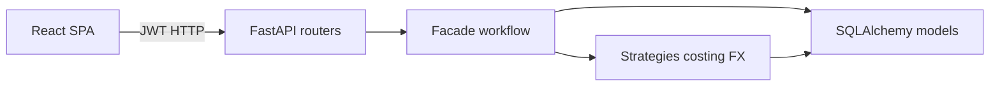
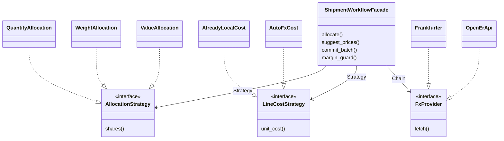

# Software engineering laws & design patterns

**Status:** Complete for MVP  
**Updated:** 2026-10-12 — layer + GoF/FX diagrams  

This note maps **Lehman’s laws of software evolution**, **GRASP**, and **GoF** patterns onto Tranz-Algo as implemented. Pair with [architecture.md](./architecture.md).

---

## Layered architecture (evolution-friendly)



```text
Frontend (React SPA)     →  HTTP / JWT
API routers (FastAPI)    →  thin Controllers
Services / Facades       →  use-cases & orchestration
Strategies               →  interchangeable algorithms
ORM models + PostgreSQL  →  persistence (SQLite fallback)
```

Separation exists so **continuing change** (Lehman) lands in the right layer instead of rewriting the whole system.  
See also the fuller diagrams in [architecture.md](./architecture.md) and [erd.md](./erd.md).

| Concern | Where it lives |
|---|---|
| HTTP auth, status codes | `backend/app/api/` |
| Allocate / suggest / commit | `services/shipment_workflow.py` (Facade) |
| Landed-cost math | `services/costing.py` + `services/strategies/` |
| FX fetch fallbacks | `services/strategies/fx_providers.py` |
| UI cost-mode labels | `frontend/src/costModes.js` |

---

## Lehman’s laws — how Tranz-Algo responds

| Law | Meaning | Project response |
|---|---|---|
| **I Continuing change** | Real systems must keep evolving | Dual cost modes, allocation methods, themes, True Cost studio, Cost history — features extend without replacing POS/customs |
| **II Increasing complexity** | Entropy rises unless actively reduced | Strategies + Facade extract branching from routers; shared `costModes.js` removes duplicated mode strings |
| **III Self regulation** | Evolution is feedback-driven | Costing unit tests + scenario docs (`docs/scenarios/`) gate formula changes; ledger events make commits auditable |
| **IV Conservation of organisational stability** | Work rate stays roughly steady | Layered MVP: ship thin API changes; domain math stays isolated in `costing` |
| **V Conservation of familiarity** | Users/devs absorb change slowly | Stable REST shapes under `/api/v1`; UI keeps familiar Shipments → True Cost → Stock flow |
| **VI Continuing growth** | Functionality tends to grow | Open extension points: new `AllocationStrategy` / `LineCostStrategy` / `FxProvider` without editing every caller |
| **VII Declining quality** | Quality drops unless maintained | pytest for worked examples; Facade keeps routers from becoming god-objects |
| **VIII Feedback system** | Multi-loop feedback | Cost history + confirm dialogs feed pricing decisions; UX confirms before destructive actions |

---

## GRASP (responsibility assignment)

| Pattern | Application in Tranz-Algo |
|---|---|
| **Information Expert** | `costing` / strategies own formula knowledge; batch ORM owns persisted line fields |
| **Creator** | Routers create ORM entities; Factories create Strategy instances |
| **Controller** | FastAPI routers accept HTTP; they delegate costing workflows to the Facade |
| **Low Coupling** | UI talks to REST only via `api.js`; costing has no FastAPI/SQLAlchemy imports |
| **High Cohesion** | `shipment_workflow` groups allocate/suggest/commit; FX providers only fetch rates |
| **Polymorphism** | Allocation & line-cost Strategies selected by name instead of long `if/elif` chains at call sites |
| **Pure Fabrication** | `shipment_workflow`, strategy factories, FX chain — invented services that don’t map 1:1 to a business form |
| **Indirection** | Facade between API and domain; provider chain between FX service and remote APIs |
| **Protected Variations** | New allocation method / FX source / cost mode registers in one place (`strategies/` or `costModes.js`) |

---

## GoF patterns in code




| Pattern | Location | Role |
|---|---|---|
| **Strategy** | `services/strategies/allocation.py`, `line_cost.py` | Quantity / weight / value allocation; Already-Local / Auto FX unit cost |
| **Simple Factory** | `get_allocation_strategy()`, `get_line_cost_strategy()` | Resolve strategy by string mode |
| **Template Method** | `compute_landed_for_method()` | Fixed steps: prepare → basis → allocate shares → assemble; steps vary via Strategy |
| **Chain of Responsibility** | `services/strategies/fx_providers.py` | Identity → Frankfurter → open.er-api |
| **Facade** | `services/shipment_workflow.py` | Single entry for allocate / suggest / commit |
| **Factory Method (app)** | `create_app()` in `main.py` | Application composition |
| **Dependency Injection** | FastAPI `Depends(get_db)`, `Depends(get_current_user)` | Supply session & user without hard-wiring |

Frontend mirrors:

| Pattern | Location |
|---|---|
| **Strategy config / Protected Variations** | `costModes.js` |
| **Provider (Context)** | `auth.jsx`, `theme.jsx` |
| **Composition** | `AppShell`, `WorkspaceForm`, `ListDrawer` |

---

## Extending safely (student checklist)

1. **New allocation basis** — add a class in `allocation.py`, register in `_REGISTRY`; add a test in `tests/test_costing.py`.
2. **New line cost mode** — add a `LineCostStrategy`, register it; add the mode to `frontend/src/costModes.js`.
3. **New FX source** — implement `FxProvider`, insert into `build_fx_provider_chain()`.
4. **New commit side-effect** — extend `shipment_workflow.commit_batch`, not the HTTP router.

This keeps Lehman’s *increasing complexity* under control while the product continues to grow.
